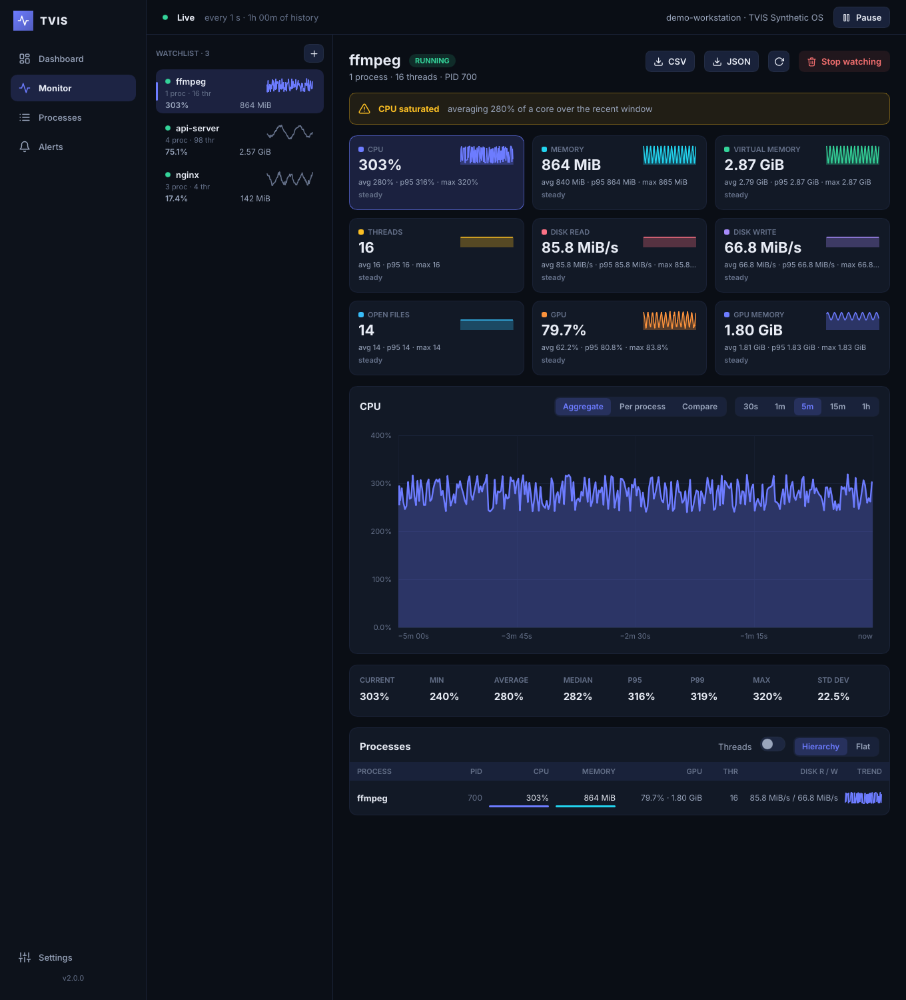
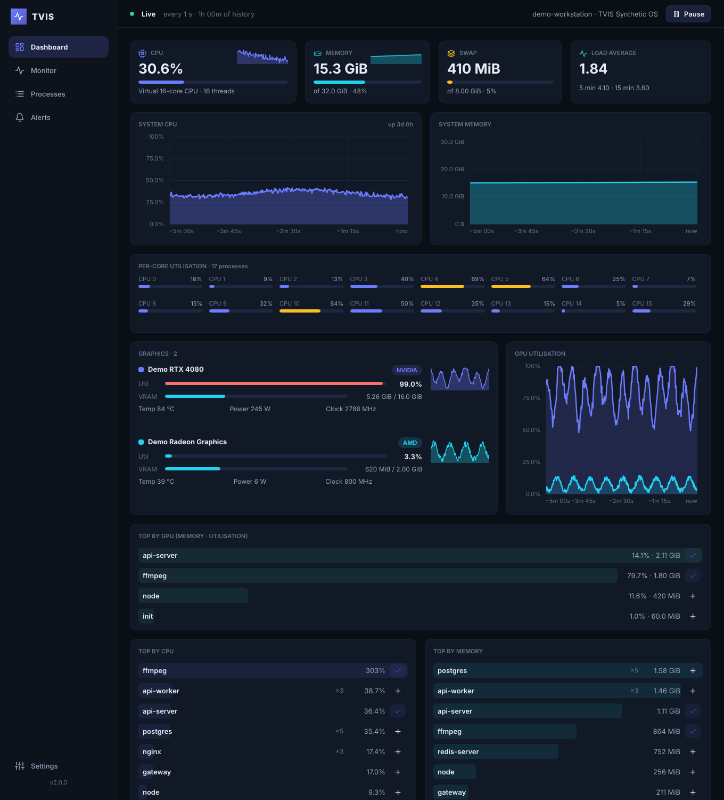

<div align="center">

# TVIS

**A professional process profiler for developers.**
See exactly how much CPU, memory, threads, disk I/O and file handles your application uses — live, over time, with automatic leak detection.

[](LICENSE-MIT)
[](https://www.rust-lang.org/)
[](https://slint.dev)
[](#installation)



</div>

## Features

- **Per-application profiles** — watch a process by name or PID; its whole process
  tree is tracked and aggregated, and children that appear later are picked up automatically.
- **Nine metrics** — CPU, resident memory, virtual memory, threads, disk read/write rate, open files, **GPU utilisation and GPU memory per process**.
- **GPU monitoring** — utilisation, VRAM, temperature, power and clock for every GPU, and what each process uses on it. NVIDIA (NVML), AMD/Intel on Linux (sysfs + DRM fdinfo), any vendor on Windows (WDDM counters), device stats on macOS. No vendor SDK is needed at build or run time.
- **Real statistics** — current, min, average, median, P95, P99, max and standard
  deviation over 30 s – 1 h windows, plus a trend per minute for every metric.
- **Automatic insights** — steady growth of memory, threads or handles (leak
  detection by linear regression), CPU saturation and spikes.
- **Three chart modes** — aggregate, per process (top 6 by usage) and a
  compare view that overlays every watched target; hover for exact values.
- **Process tree** with per-process sparklines, hierarchical or flat, optional thread rows.
- **Alerts** — "CPU above 90 % for 10 s", "memory above 2 GiB"; firing/resolved
  log and toasts.
- **Export** history as CSV or JSON, or record headlessly from a script:
  `tvis record my-service -d 120 -o run.csv`.
- **System dashboard** — CPU, memory, swap, load, per-core utilisation, top processes.
- **Customisable** — dark/light/system theme, accent colour, sampling interval
  (250 ms – 10 s), retention (5 min – 24 h), smoothing, line weight, grid, area fill,
  binary/decimal units, CPU relative to one core or the whole machine.
- **Fast** — Slint is retained-mode; the interface is not re-laid-out for every
  chart update, and all number crunching happens off the UI thread.
- **Cross-platform** — Linux (X11 and Wayland), Windows and macOS.

<div align="center">



</div>

## Installation

### Download a binary

Pre-built binaries for Linux (x86_64, aarch64), Windows and macOS (Intel, Apple Silicon)
are attached to every [release](https://github.com/charl1e7/tvis/releases).

### Build from source

Requires Rust 1.95 or newer.

```bash
cargo install --git https://github.com/charl1e7/tvis tvis
```

On Linux you need the usual windowing libraries at build time, e.g. on Debian/Ubuntu:

```bash
sudo apt install libfontconfig1-dev libxkbcommon-dev libxkbcommon-x11-dev libx11-xcb-dev libwayland-dev
```

## Usage

```bash
tvis                       # open the app
tvis -w java -w postgres   # start watching processes
tvis --demo                # explore with a synthetic machine
tvis --no-gpu              # skip GPU probing
tvis record nginx -d 60 -o nginx.json   # headless recording (csv or json)
```

Settings, the watchlist and alert rules are stored as `settings.toml` in your
platform configuration directory (override with `--config-dir` or `TVIS_CONFIG_DIR`).

## Architecture

TVIS is a workspace of three crates: `tvis-core` (engine, no UI), `tvis-gpu`
(GPU backends) and `tvis` (Slint application). New metrics, data sources, insights and pages plug in
without touching the core. See [docs/ARCHITECTURE.md](docs/ARCHITECTURE.md).

## Development

```bash
cargo test --workspace
cargo clippy --workspace --all-targets
cargo run -- --demo
```

## GPU support details

| Platform | Device data | Per-process data | Notes |
|----------|-------------|------------------|-------|
| NVIDIA, Linux | NVML | memory + utilisation | needs the proprietary driver (`libnvidia-ml`) |
| NVIDIA, Windows | NVML | via WDDM counters | |
| AMD, Linux | sysfs (`gpu_busy_percent`, VRAM) + hwmon (temperature, power, fan) | DRM `fdinfo` | processes of other users need root to be inspected |
| Intel, Linux | hwmon / frequency | DRM `fdinfo` | no device-wide utilisation counter without root |
| Any GPU, Windows | WDDM counters | engine time + dedicated VRAM | Windows 10 1709+ |
| macOS | IOKit statistics | not available | the OS exposes none to unprivileged programs |

Without a supported GPU the GPU sections simply do not appear.

## Credits

Icons are from [Feather](https://feathericons.com) (MIT).

## License

MIT — see [LICENSE-MIT](LICENSE-MIT).
